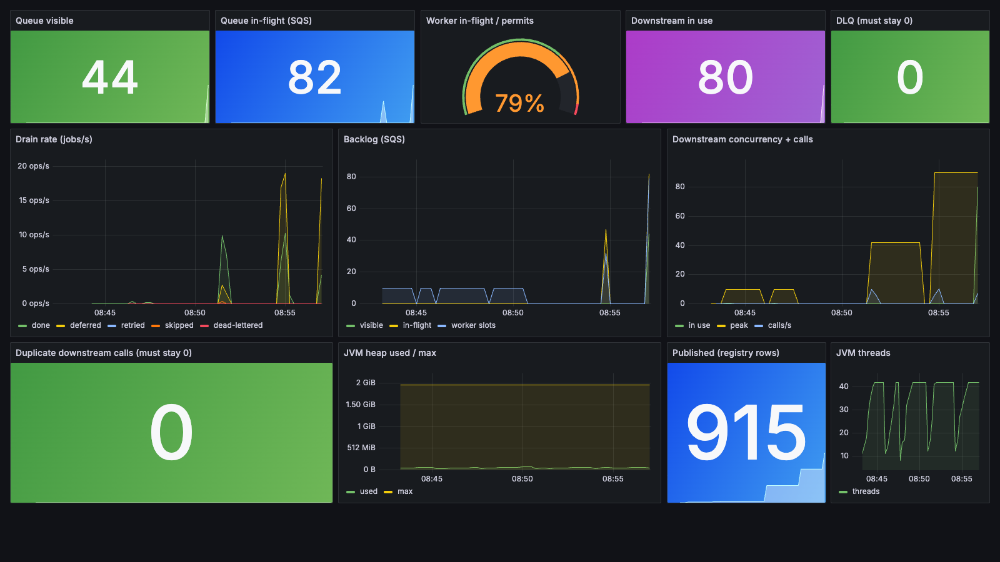
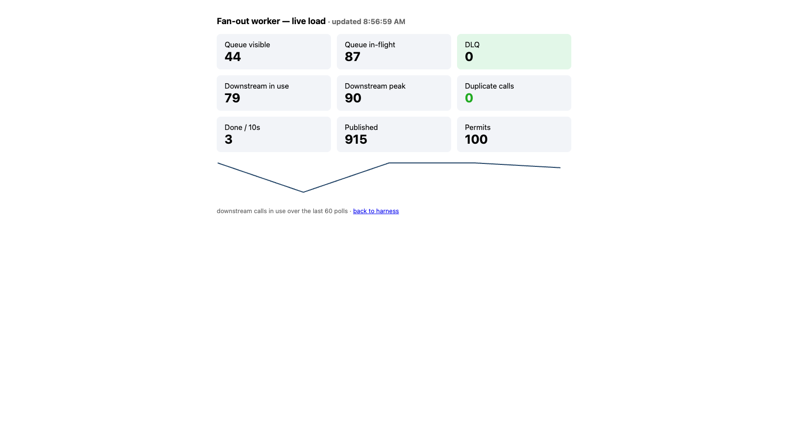
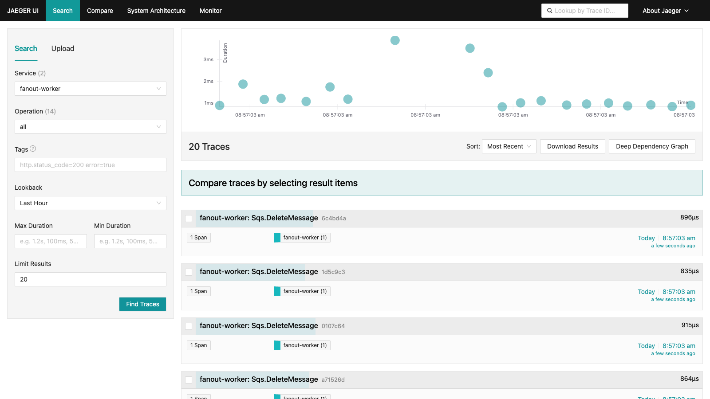

# Presentation round — observability & polish (2026-10-27)

Branch `presentation`. Everything here runs in compose and was validated end to end today.

## What we added today

| Piece | What it gives the demo |
|---|---|
| **OpenTelemetry javaagent** (pinned 2.14.0, attached in the Docker image — zero code change) | Traces for every SQS / DynamoDB / downstream-HTTP call, exported OTLP → Jaeger (http://localhost:16686) |
| **`GET /prom`** Prometheus-text endpoint in the ops API | Queue + DLQ depth, worker outcome counters, downstream concurrency, JVM heap/threads — scraped every 5 s |
| **Prometheus + Grafana** (provisioned, anonymous) | 12-panel live load dashboard: http://localhost:3000/d/fanout-load |
| **`frontend/dashboard.html`** | Dependency-free live panel polling `/metrics` at 1 s: http://localhost:5173/dashboard.html |
| **Terraform `modules/alarms`** | Per region: DLQ not empty, backlog age > 600 s, worker dead-lettered (EMF counter) + a CloudWatch dashboard. This closes the "Observability and SLOs" item the checklist had as *designed only* — it is now **done** |

## The screenshots

### Grafana — live load (mid-drain, 300 jobs)

Worker at 79% of permits, backlog draining, downstream peak 87 concurrent, **DLQ 0, duplicate downstream calls 0**.

### Live ops panel (works even without Grafana)

90 of 100 permits busy, queue draining, DLQ green.

### Jaeger — per-message traces

`Sqs.DeleteMessage` spans and friends on `fanout-worker` — the waterfall a reviewer would ask for.

## What the metrics caught the same day (the staff-engineer story)

1. **Counter-reset bug**: `flushMetrics` used `sumThenReset`, zeroing the same counters a scraper reads — Prometheus would have seen a reset every 5 s and garbage rates. Fixed: counters are cumulative, the EMF flush computes deltas.
2. **Gauge semantics**: the permit semaphore reads ~10/100 "in-flight" on an *idle* system because the poll loop reserves the next batch's slots during the SQS long-poll. The scrape now reports jobs inside `process()`; the capacity view stays on the EMF line.
3. **Silent contract drift**: the Bruno re-run caught `dlq.visible` serialized as a JSON *string* since the Jackson refactor — the recorded 18/18 predated it. Fixed at the source (`depth()` parses to numbers).

## Demo script (5 minutes)

```sh
docker compose -f infra/docker-compose.yml up -d                      # everything
(cd infra/terraform/envs/local && terraform apply -auto-approve)      # queues/tables/alarms
SIM_LATENCY_MS=3000 docker compose -f infra/docker-compose.yml up -d --force-recreate backend
# publish 300 (button on http://localhost:5173, or the locust run) and narrate:
#   :3000/d/fanout-load?kiosk   — backlog drops, worker gauge climbs, DLQ/duplicates stay 0
#   :16686                      — open one trace, show SQS → DynamoDB → downstream waterfall
#   :5173/dashboard.html        — ops view without any observability stack
```

## Global infra pricing (verified 2026-10-27, us-east-1 list prices)

### Unit prices — checked against aws.amazon.com this week

| Service | Unit | Price | Note |
|---|---|---|---|
| DynamoDB on-demand write | WRU | **$0.625/M** | 50% cut in Nov 2024 — our old doc assumed $1.25/M (2x high) |
| DynamoDB on-demand read | RRU | **$0.125/M** | same cut |
| DynamoDB provisioned (rejected) | WCU / RCU | $0.00065/h / $0.00013/h | = $0.18/M writes at 100% utilization; break-even vs on-demand at 29% sustained utilization |
| DynamoDB storage | GB-month | $0.25 | registry ~800k-2.4M rows ≈ 0.4-1.2 GB → under $0.30 |
| SQS standard (3 requests/message) | request | **$0.40/M** | first 1M/month free; tiers $0.30/M >100B, $0.24/M >200B (we never get there) |
| API Gateway REST (we need API keys) | request | **$3.50/M** | first 333M; HTTP APIs are $1.00/M but have no API-key/usage-plan support |
| Fargate (Linux x86) | vCPU + GB | $0.04048/h + $0.004445/h | 1 vCPU + 2 GB = **$36.03/task-month**; Graviton (arm64) is ~20% less |
| CloudWatch (EMF path) | metric/alarm/dashboard | $0.30 metric-mo / $0.10 alarm / $3 dashboard | EMF rides log ingestion ($0.50/GB): our flush ≈ 40 MB/month total → ~$10/mo itemized; $60 allowance kept below for headroom |

### Monthly cost by load level (the 3 scale scenarios)

| Monthly line | LOW (OPTIMISTIC, 4k firms / 800k eng.) | MID (6k / 1.2M) | HIGH (PESSIMISTIC, 12k / 2.4M) |
|---|---|---|---|
| Fargate, 2 tasks x 3 regions ($36.03) | 216 | 216 | 216 |
| DynamoDB writes (3.46M / 5.19M / 10.4M x $0.625) | 2.2 | 3.2 | 6.5 |
| DynamoDB reads (12.3M / 18.4M / 36.8M x $0.125) | 1.5 | 2.3 | 4.6 |
| SQS (10.4M / 15.6M / 31.2M req x $0.40) | 4.2 | 6.2 | 12.5 |
| API Gateway (8.8M / 13.2M / 26.4M x $3.50) | 31 | 46 | 92 |
| LLM summaries (173 x $0.25) | 43 | 43 | 43 |
| Observability allowance | 60 | 60 | 60 |
| **TARGET total** | **358** | **376** | **435** |
| vs caps ($1k / $3k / $10k) | 36% | 13% | 4% |
| **LEAN** (1 task/region, rule-based summaries) | **207** | **225** | **285** |

Even HIGH scale — double the firms, double the traffic — costs **less than half the $1k cap**: the always-on Fargate workers and the API Gateway dominate; DynamoDB and SQS together are under $25 at any scale. There are no global-tables replication charges (each region's registry is independent by design — data residency); replicating writes would double DynamoDB write costs.

### The capacity-mode decision (DynamoDB), in one box

> **On-demand.** Provisioned is ~3.4x cheaper per op but only at 100% utilization; break-even is 29% sustained. Our traffic is burst-drain-idle: provisioning for the peak (200 WCU x 3 regions) ≈ **$285/mo vs $4-11 on-demand** — and throttling risk on the backfill. When spend stabilizes, buy a **Database Savings Plan** (1-yr, up to 18% off on-demand), not reserved provisioned capacity (locked to provisioned mode + steady load).

### Savings levers if the caps ever get tight (in order of dollars)

| Lever | Saves | Cost |
|---|---|---|
| Graviton (arm64) Fargate tasks | ~20% of the compute line (~$43/mo) | rebuild image for arm64, no code change |
| LEAN tier (1 task/region, rule summaries) | ~$150/mo | gives up the LLM narrative |
| Database Savings Plan (1-yr) | up to 18% of DynamoDB | 1-year spend commit |
| SQS/API GW tiered discounts | cents at our volume | n/a — irrelevant below 100B/mo |

## The six gaps we name ourselves — and what we did about them

Context: the whole take-home (design doc + worker + tests + infra + load + evidence) was produced in a **4-hour working window**. These six are the things a staff engineer would do next; two are done today, four have written plans. We name them ourselves — the list is the deliverable.

| # | Gap | Status | What we did / the plan |
|---|---|---|---|
| 1 | **Backfill not de-risked** (our own #1 risk: `checkpoints` table unused, confirm-on-touch unproven) | **Planned** (design + script exist; prototype is the next work item) | Prototype (1 day): a `backfill` CLI that lists engagement IDs, walks them through the same `publish` path in checkpointed batches (`checkpoints` row per package: `pending/confirmed`), and a drift probe that touches 1% of engagements daily and compares registry vs source. Acceptance: a killed mid-backfill run resumes exactly where it stopped; confirm-on-touch repairs a wiped registry row. |
| 2 | **Multi-instance worker story** (firm limiter + counters are per process) | **Planned** | Two options written down: (a) shared firm limiter in DynamoDB (token-bucket row per firm, `ADD` update — same primitives the shared breaker already uses), or (b) explicit one-worker-per-region, scale = regions, and document it as a capacity model. Decide with real-AWS throughput data; the breaker pattern is the template either way. |
| 3 | **User-visible SLO not measured** (we measured status-read latency, not publish→badge) | **Done today** ✅ | New `locust/badge_slo.py` probe, run recorded in `results/locust/badge-slo.json`: **solo publish→badge p50 0.38 s / p95 0.39 s / max 0.42 s** (requirement: "within seconds" — met with margin); **batch of 200: p50 7.6 s / p95 9.4 s**, 0 missing badges. Next: add it to the nightly load run and alarm on it (p95 > 30 s). |
| 4 | **No runbook** (alarms existed, on-call actions didn't) | **Done today** ✅ | `docs/RUNBOOK.md`: every alarm → diagnosis → action (incl. "never delete DLQ messages", redrive is safe because idempotency holds), plus the known limits an on-call must know before acting. |
| 5 | **No fault injection beyond unit level** | **Planned** | Integration-level chaos (half a day on the existing LocalStack harness): kill SQS mid-drain (assert: redelivery, 0 duplicates), DynamoDB throttling mid-drain (assert: breaker opens and half-opens on schedule), kill -9 the worker mid-batch (assert: lease expiry retakes claims — already proven in one integration test, extend to batch). |
| 6 | **No threat model** | **Planned** (partial controls live: gateway API key + usage plan, fail-closed admin token, id validation) | One page: worst attack = unauthenticated publish floods downstream permits (answered by gateway key + quota); admin actions need a real authorizer (the gateway key does not cover :8080); data-at-rest is DynamoDB-encrypted by default; open question for security review: per-key publish rate limits per firm. |

The meeting line: *"In 4 hours we chose evidence over breadth: the core is built and measured, the risky edges are named with plans, and the two cheapest credibility gaps (SLO measurement, runbook) we closed the same day."*

## What is still open (said out loud, not hidden)

| Gap | Why it's acceptable / next step |
|---|---|
| Summary generation (brief section 4) is design-only | Costed and designed in the design doc; the fan-out core was the build target |
| `checkpoints` table is design-only — backfill has no checkpointing | Prototype plan written (six-gaps table above, #1) |
| Per-firm limiter is per-process | Two options written down (six-gaps table, #2); one-worker-per-region is the current capacity model |
| Real-AWS validation of alarms/gateway enforcement | LocalStack community does not enforce API keys or `PutDashboard`; alarms module takes `enable_dashboard=true` there; wire SNS to `alarm_actions` |
| SLO thresholds are estimates | Alarm thresholds are first guesses; tune after real-AWS data |
| ~~Cost table prices unverified~~ **Closed 2026-10-27**: all infra unit prices verified against aws.amazon.com (full table above); DynamoDB on-demand is actually $0.625/M writes, $0.125/M reads (Nov 2024 50% cut — our table had it 2x high). **Prod decision: DynamoDB on-demand** — provisioned only wins above 29% sustained utilization; peak-provisioning our bursty drain ≈ $285/mo vs $4-11. Later lever: Database Savings Plan (1-yr, up to 18% off on-demand), not reserved provisioned capacity. | Totals by load level: $358 / $376 / $435 (LOW / MID / HIGH) |
| `results/integration/` reports from 2026-10-26 | Refreshed 2026-10-27 (8/8 LocalStack); `mvn verify` re-runs them any time |

Evidence for every layer: [results/](../results/) — unit 30/30, Bruno 18/18, Playwright 3/3, Locust 6/6 (2026-10-27).
